<!-- chrome: false -->

Note: Hey everyone, thanks for coming. Today is all about Docker Sandboxes. By the end of this session I want you walking out with one clear picture in your head: a box you can trust, that you get to fill with whatever you need, and that your whole team can share. That's it. That's the talk. Everything else is details and demos, and there are plenty of demos, so if something breaks live, you'll get to watch me sweat in real time.

---

<!-- chrome: false -->

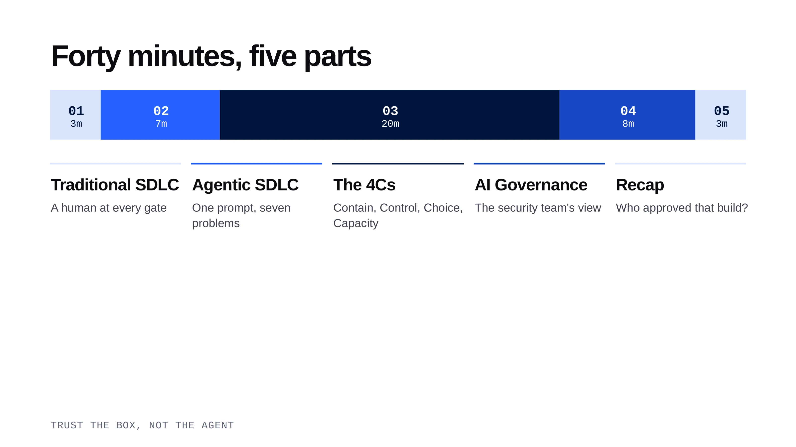

Note: Very quickly, so you know who's talking at you. My name is Ajeet Singh Raina, I'm a Developer Advocate at Docker. I've spent a little over twenty years in this industry — systems integration, testing, consulting, and developer relations. I was a Docker Captain before I joined the company, and I run a developer meetup in Bengaluru that's grown to about seventeen thousand people. I also co-wrote a book called Operational AI with Docker , which is honestly this talk stretched out to a few hundred pages. But you didn't come here for my résumé. You came here because somewhere in the last few weeks, an agent did something on your machine — or on a machine you're responsible for — that made your stomach drop just a little. Let's talk about that feeling, and then let's

---

<!-- chrome: false -->

Note: Here's the plan. We'll start with the problem, because sandboxes only make sense once you feel the pain. Then a quick detour: why not just use containers? Spoiler, I'm going to break out of one live. Then we'll say hello to sandboxes and walk through four pillars: Contain, Control, Choice, and Capacity. If you caught the WeAreDevelopers keynote, these will sound familiar. They're a really nice way to think about the whole thing.

---

<!-- chrome: false -->

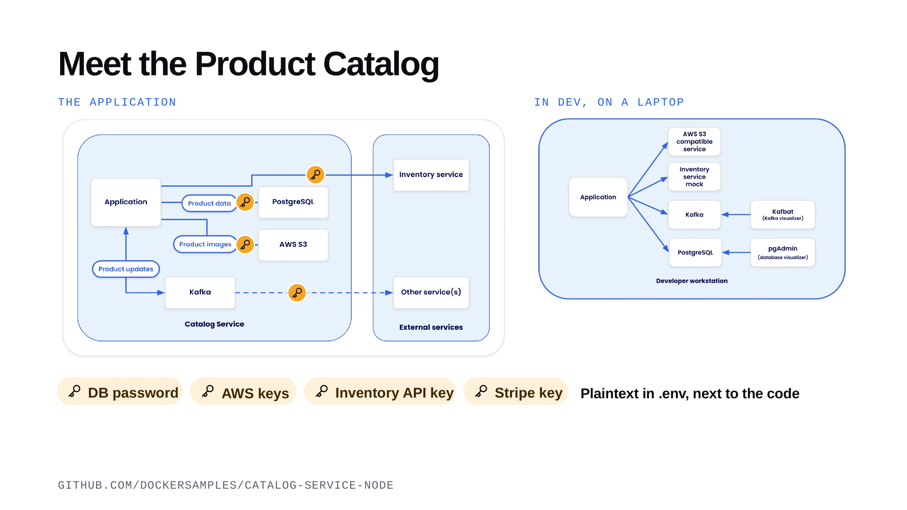

Note: So let's start with the problem. Everybody wants the productivity agents promise. Nobody wants to be the person whose agent did something weird on a Friday afternoon. How do we get the first thing without the second?

---

<!-- chrome: false -->

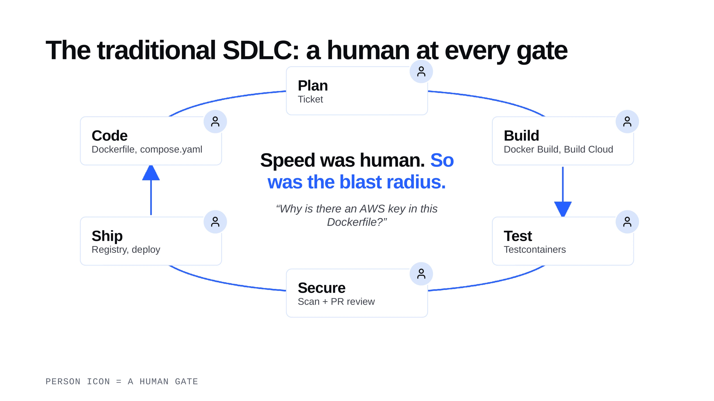

Note: Agents earn their keep by acting: reading code, running builds, installing packages, calling APIs. Freedom is the feature.

---

<!-- chrome: false -->

Note: Same agent, same mistake, very different outcome depending on what it can reach. Developers want agents; security teams want control; today they cannot have both.

---

<!-- chrome: false -->

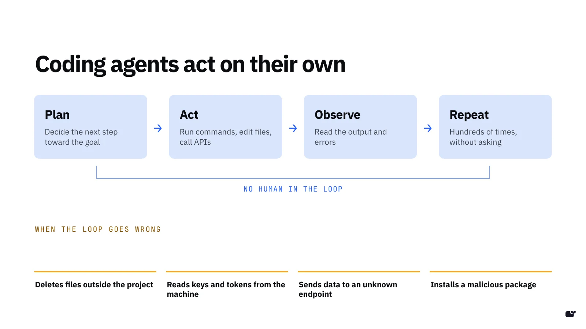

Note: Here's what makes an agent an agent. It plans, it acts, it looks at what happened, and it does it again. Over and over. Hundreds of times. And the whole point is that you're not in that loop. That's the magic. It's also the problem. Because when that loop goes sideways, it can delete files outside your project, it can go poking through your keys and tokens, it can send data somewhere you've never heard of, or it can happily install a package that turns out to be malicious. Not because it's evil. Just because it's trying really hard to finish the task.

---

<!-- chrome: false -->

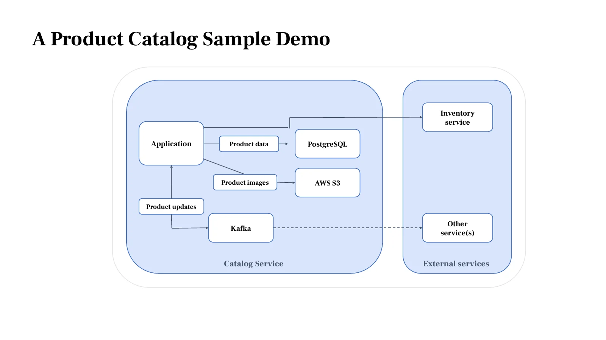

Note: So this is the app we'll be securing all the way down that dev-to-prod road. It's a Product Catalog service, and it's deliberately realistic rather than a toy. In the middle you've got the catalog-service application, and it's not living alone: it writes product data to PostgreSQL, pushes product images to AWS S3, and publishes product updates through Kafka. Reaching outside its own boundary, it talks to an Inventory service and other downstream services. The point I want you to take away is that this is a real supply chain of moving parts - every one of those boxes is something we eventually have to trust and prove. Before we talk about how to fix any of it, I want you to feel it yourself - so let's try.

---

<!-- chrome: false -->

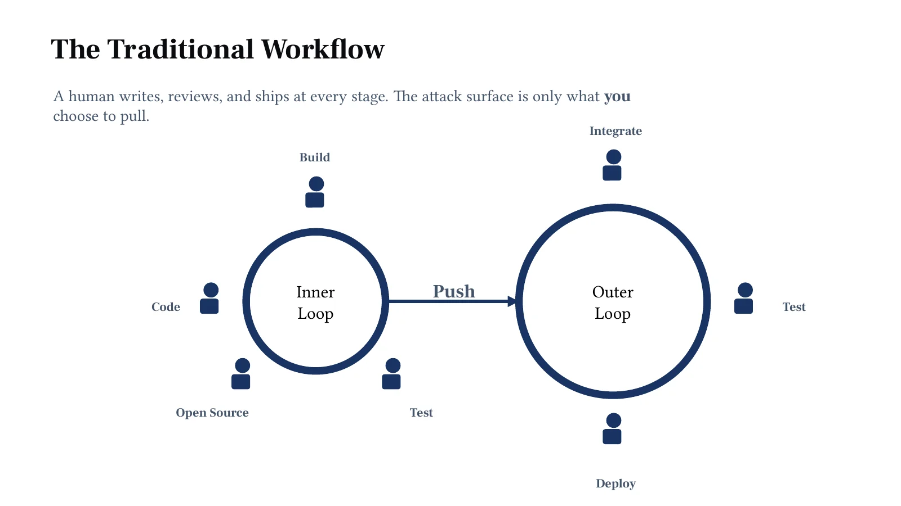

Note: Here's the world we grew up in - the traditional workflow. A human writes, reviews, and ships at every stage, and the key line is at the top: the attack surface is only what you choose to pull. You've got the inner loop on the left - code, open source, build, test - the fast cycle on your own machine, and every icon around it is a person. Then you push, and it flows into the outer loop on the right - integrate, test, deploy - again, humans at every point. It's a chain of deliberate human decisions from left to right. Hold this picture in your head, because the next slide keeps the exact same map and swaps out just one thing.

---

<!-- chrome: false -->

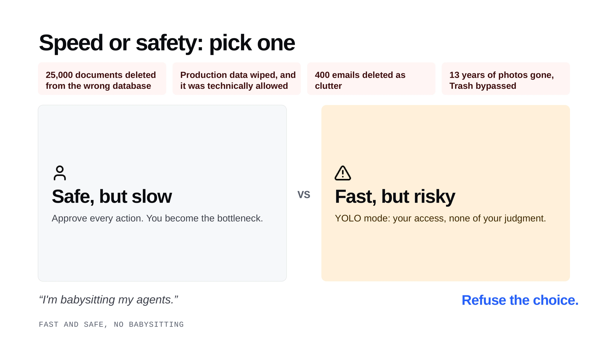

Note: Same map, same inner and outer loops, same push in the middle - but look what changed: every human icon is now an AI agent. That's the whole point. In the agentic workflow, an agent sits at every single stage - code, open source, build, test, integrate, deploy - and so the attack surface is no longer just what you pull. It's every autonomous action, every tool call, every credential those agents touch across the entire road from inner loop to production. That's a lot of green robots and a lot of blast radius - the same failure mode as that 2:47 AM commit, now at every stage. Let me make it concrete - here's an agent turned loose on a build with no guardrails at all.

---

<!-- chrome: false -->

Note: Traditional attacks targeted developers making conscious choices. Agentic systems automate those choices — an agent can pull and install packages without a human reviewing each step. The attack surface multiplied.

---

<!-- chrome: false -->

Note: Traditional attacks targeted developers making conscious choices. Agentic systems automate those choices — an agent can pull and install packages without a human reviewing each step. The attack surface multiplied.

---

<!-- chrome: false -->

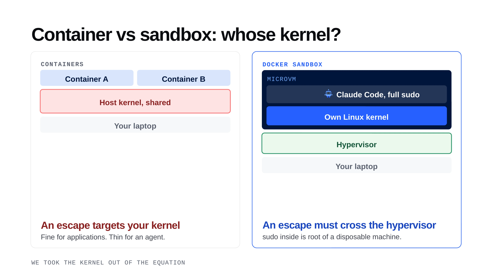

Note: And this isn't the future. It's already in your pipeline. Agents pull dependencies from registries you never audited. They generate Dockerfiles, often with the first base image they see. They edit infrastructure: Terraform, Helm values, Compose files, IAM policies. And they trigger builds on their own, opening PRs, pushing branches and kicking off pipelines. So, what can go wrong?

---

<!-- chrome: false -->

---

<!-- chrome: false -->

Note: Run the docker/ai-reviewer project

---

<!-- chrome: false -->

Note: So today, developers are stuck picking a side. On one end, you approve every single action. Very safe. Also very slow, and you've basically become a full-time button clicker. On the other end, YOLO mode. Skip all the permissions, let it rip. Super fast, but now the agent has exactly the same access you do. Everything you can touch, it can touch. And that's where you hear people say things like, I'm babysitting my agents. Nobody signed up to be a babysitter. We want the right side's speed with the left side's safety.

---

<!-- chrome: false -->

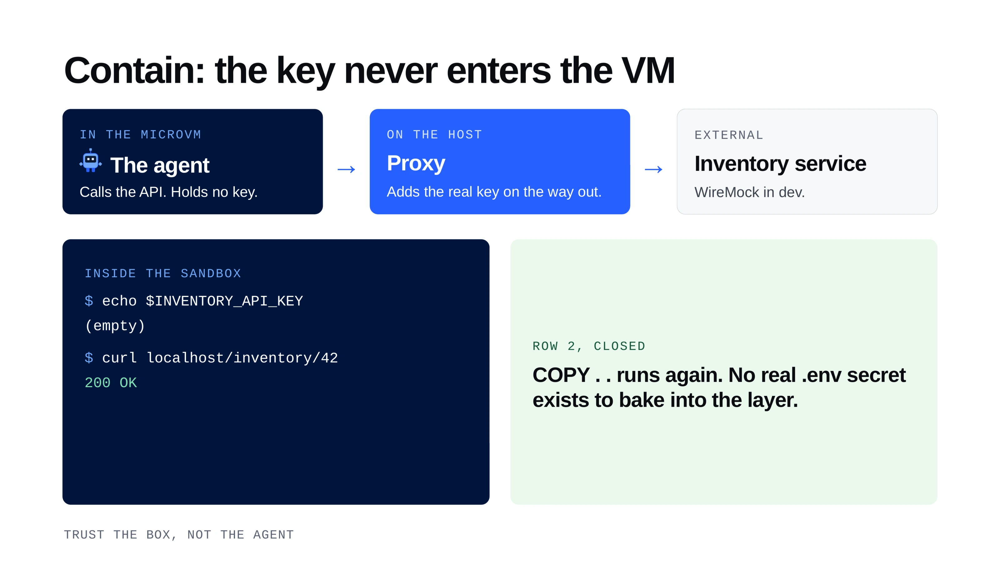

Note: Okay. Some of you are already thinking: we're at a Docker talk, just put the agent in a container. Fair! Containers are great at isolating applications. But agents aren't applications. They need a lot more access to be useful. Let me show you what happens.

---

<!-- chrome: false -->

---

<!-- chrome: false -->

---

<!-- chrome: false -->

Note: Run the docker/ai-reviewer project

---

<!-- chrome: false -->

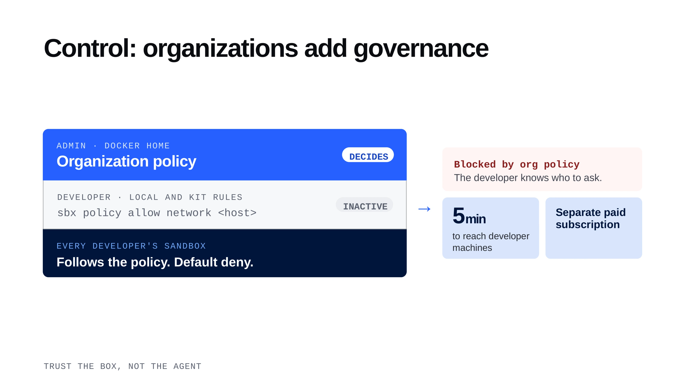

Note: So what just happened? Here's the pattern. Every time you give the agent something useful, you chip away at the box. Mount your source code? Now it can change files on your host. Give it network access? It can reach anything, internal or external. Pass in API keys as environment variables? It can read them and send them wherever it likes. And mount the Docker socket? Well, you just saw that one. Isolation is basically gone. The more useful you make the agent, the less isolated the container actually is. That's not a bug in containers. It's just not what they were built for.

---

<!-- chrome: false -->

Note: So we need something different. Something where you can give the agent everything it needs, but it still can't get out. Say hello to Docker Sandboxes.

---

<!-- chrome: false -->

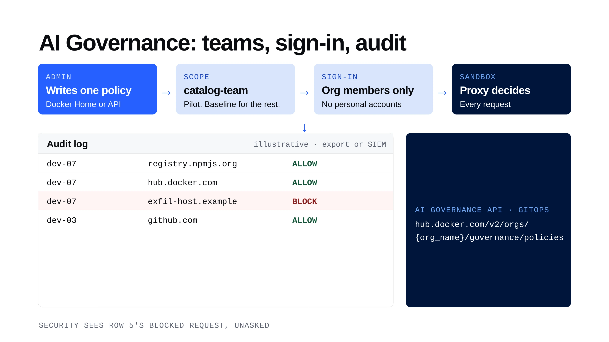

Note: Here's the mental model, and if you remember one slide, make it this one. Think of a sandbox as a private machine just for your agent. On the outside is your laptop with all your stuff: your SSH keys, your other projects, your own Docker. Inside the sandbox there's a microVM, and that's where the agent lives. It gets your project folder, and only that folder. It even gets its own Docker engine, so it can build and run containers all day without ever touching yours. And when it wants to talk to the internet, there's exactly one way out: through the proxy. Three ideas fall out of this. A trusted boundary. You choose what goes inside. And the whole team can reproduce the same setup.

---

<!-- chrome: false -->

Note: We'll organize the rest of the talk around four pillars. Contain is the boundary itself: the microVM and the guarded network. Control is where you decide where that boundary sits, and where organizations can layer on governance. Choice is about choosing what goes inside, using kits. And Capacity is about making that same sandbox show up for every developer and every run. The first two give you the trusted boundary, the third is your choice, and the fourth is sharing.

---

<!-- chrome: false -->

---

<!-- chrome: false -->

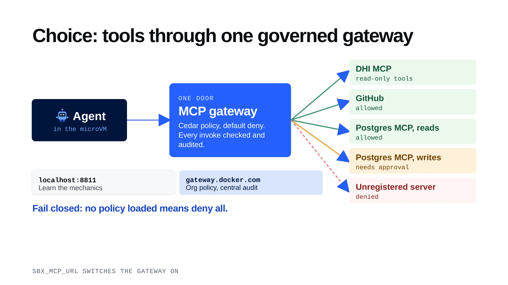

Note: Pillar one, Contain. Let's look at the actual boundaries that keep the agent's actions inside the box.

---

<!-- chrome: false -->

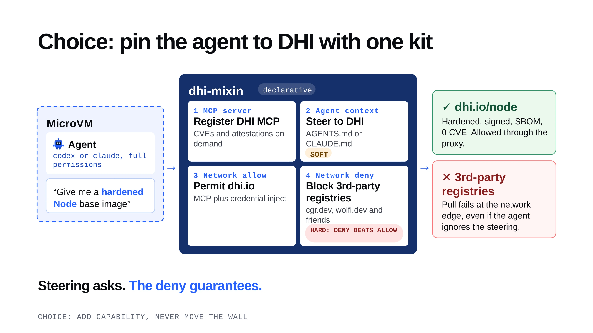

Note: There are three boundaries, and I like to think of them like a building. Number one, the microVM. That's a separate room with its own walls. Its own kernel, its own filesystem, its own Docker. Your host just isn't reachable from in there. Number two, the network proxy. That's the front desk. Every request heading out passes the desk, and the desk checks it against policy. Number three, credential injection. The front desk also holds the keys. The agent never carries them. When a request needs a key, the desk adds it on the way out. So inside the room, the agent can go wild. It's the walls and the desk that keep everybody else safe.

---

<!-- chrome: false -->

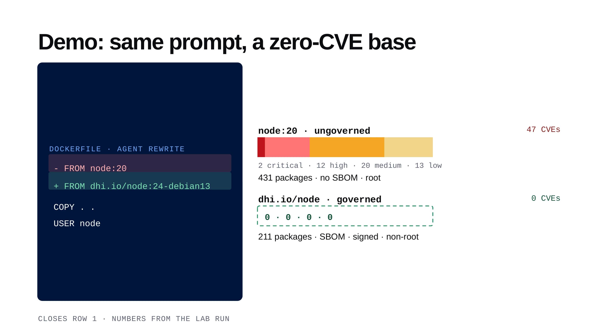

Note: Let's zoom into that credential bit, because it's honestly my favorite part. The agent wants to call some API. It sends the request with no key at all. The proxy catches it and asks, is this destination allowed? If not, it stops right there. If it is, the proxy grabs the key that's stored on your host and attaches it. The API answers, and the agent gets the result. But the key itself? Never went into the sandbox. So even if the agent gets tricked into dumping every secret it can find, there's nothing to dump.

---

<!-- chrome: false -->

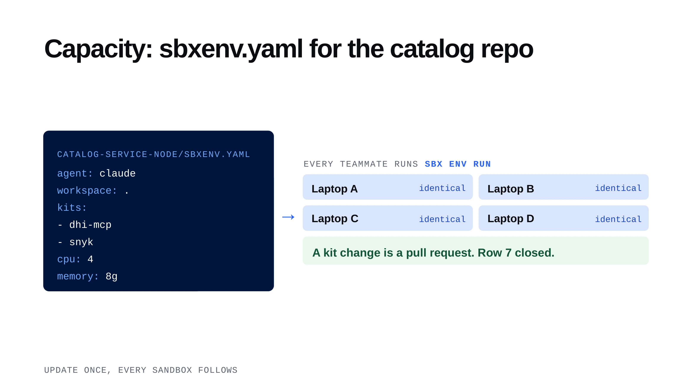

Note: Run the docker/ai-reviewer project

---

<!-- chrome: false -->

Note: Pillar two, Control. Contain gives us walls. Control is about deciding where those walls sit, so the agent can actually get work done.

---

<!-- chrome: false -->

Note: As a developer, you pick how tight the network is. There are three profiles. Locked Down is the strictest: only what you explicitly allow. Balanced is the default: the common dev stuff like package registries just works, and everything else is denied. Open lets outbound traffic through but still logs it. On top of any profile, you can add your own allow and deny rules. And because everything goes through the proxy, everything gets logged. Run sbx policy log and you can see exactly what the agent tried to reach. It's weirdly satisfying, and occasionally a little alarming.

---

<!-- chrome: false -->

Note: Now, if you're an organization, you probably want more than every developer doing their own thing. That's where AI Governance comes in. Think of it as layers. At the bottom, Contain is always on. MicroVM, proxy, credential injection, no matter what. In the middle, developers set their local policy. And on top, the organization can set central policy, collect audit logs, and say which agents and kits are approved, enforced across every sandbox. So the security team gets visibility and guardrails, and developers still get to move fast.

---

<!-- chrome: false -->

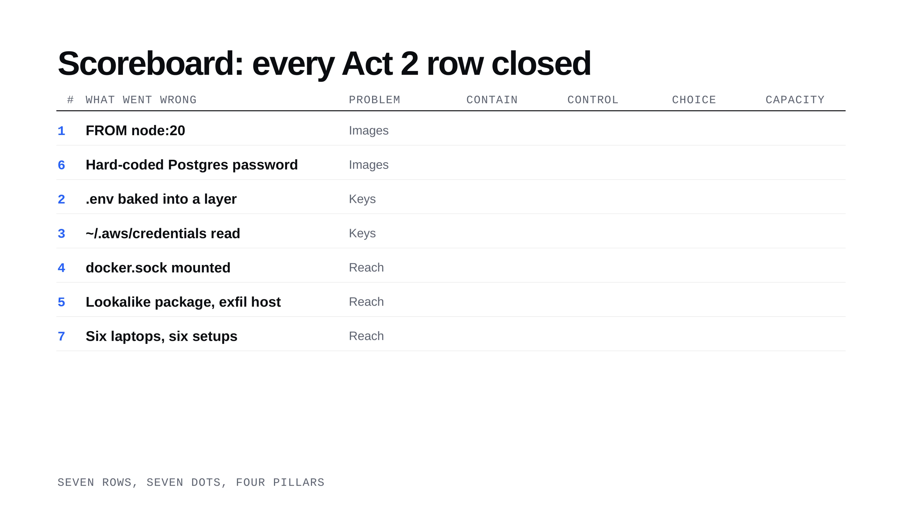

Note: Demo time. Cue: have the agent hit an endpoint that's blocked. Show it fail. Pull up the policy log and find the denied request. Allow it, and let the agent carry on.

---

<!-- chrome: false -->

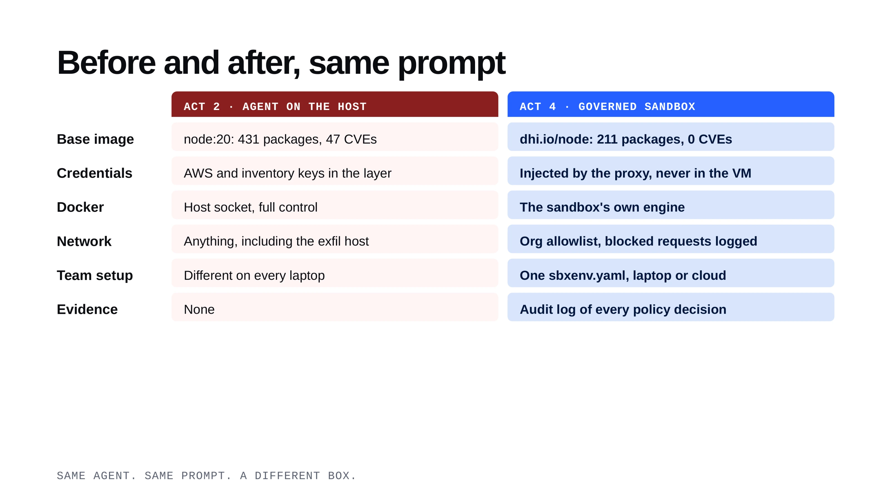

Note: Pillar three, Choice. So we've got a nice locked-down box. Great. But a locked-down box with none of your tools in it isn't very useful. How do you make it work for your team, with your agent, your tools, your endpoints?

---

<!-- chrome: false -->

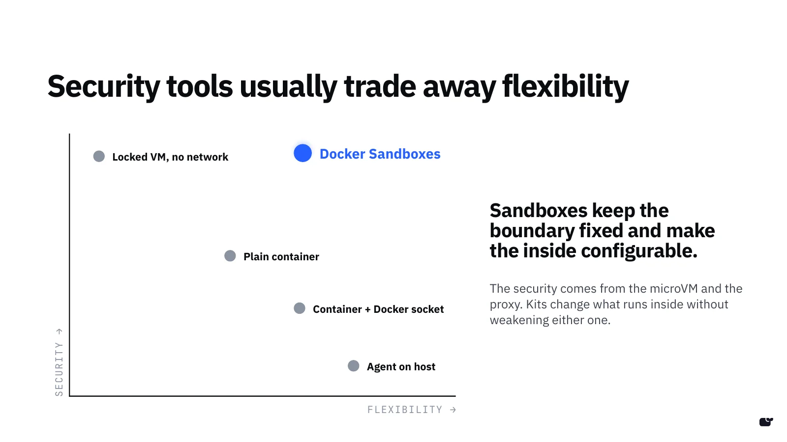

Note: Here's the thing about most security tools. They live on this diagonal. The more secure something is, the less flexible it gets. A locked VM with no network is super secure and super annoying. Run the agent right on your host and you get total flexibility and basically zero security. Containers sit somewhere in the middle and slide down the line as you add capabilities. Sandboxes break out of that line. The security comes from the microVM and the proxy, and those never change. What runs inside is completely up to you. So you don't have to pick.

---

<!-- chrome: false -->

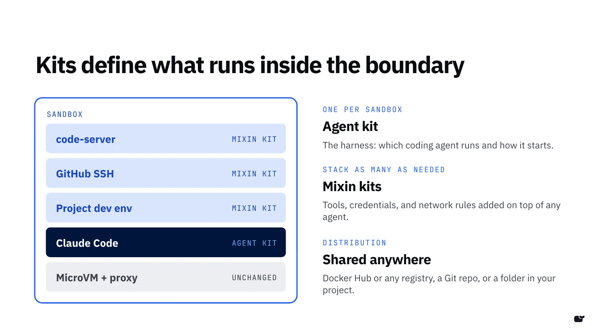

Note: The way you fill the box is with kits. There are two flavors. Agent kits are the harness: which coding agent runs and how it starts up. You get one per sandbox. Mixin kits are everything else: tools, credentials, network rules. Stack as many as you want on top of any agent. And kits can come from basically anywhere. Docker Hub, any container registry, a Git repo, or just a folder in your project. Underneath all of it, the microVM and proxy stay exactly the same.

---

<!-- chrome: false -->

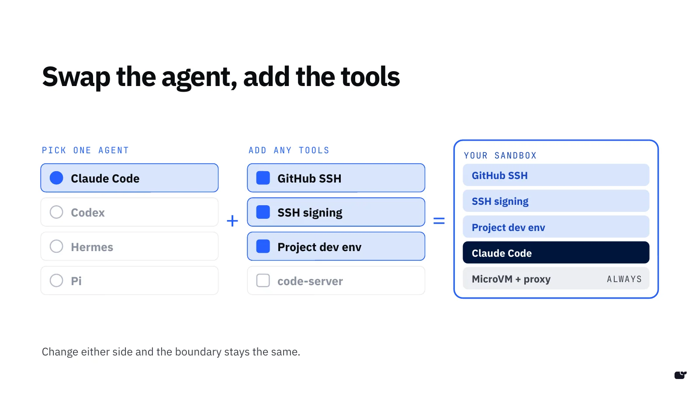

Note: And this is where it gets fun, because it's really just mix and match. Pick one agent. Claude Code, Codex, Hermes, Pi, whatever your team likes. Then add whatever tools you need: GitHub over SSH, SSH commit signing, your project's dev environment setup, maybe code-server if you want VS Code in the browser. Out comes your sandbox. Don't like the agent? Swap it. The tools stay. Need another tool? Add it. The agent stays. And either way, the boundary doesn't budge.

---

<!-- chrome: false -->

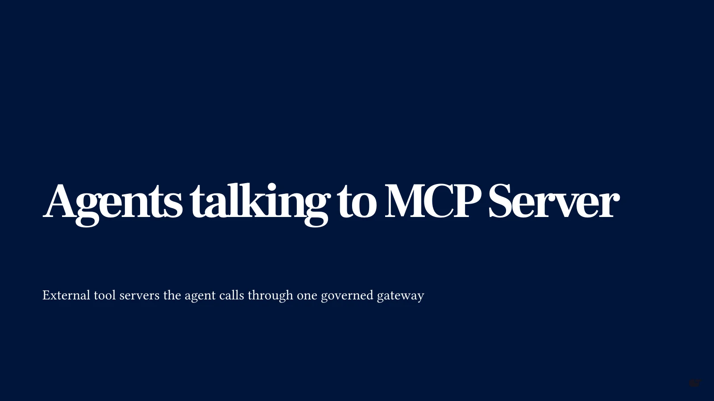

Note: external tool servers the agent calls through one governed gateway

---

<!-- chrome: false -->

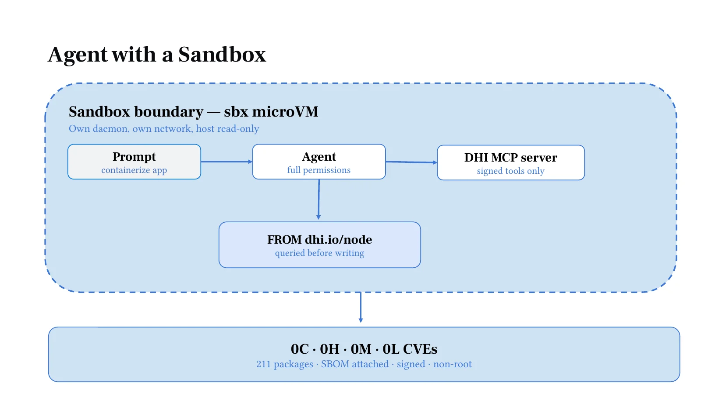

Note: Now the same prompt as our ungoverned agent: containerize the app. But this time it runs inside a sandbox, with its own daemon and its own network. Before writing the Dockerfile, the agent asks the DHI MCP server for a hardened base, and it picks dhi.io/node. The result: 211 packages, zero critical, zero high, zero medium, zero low CVEs. SBOM attached, signed, non-root. Same agent. Same prompt. Different environment.

---

<!-- chrome: false -->

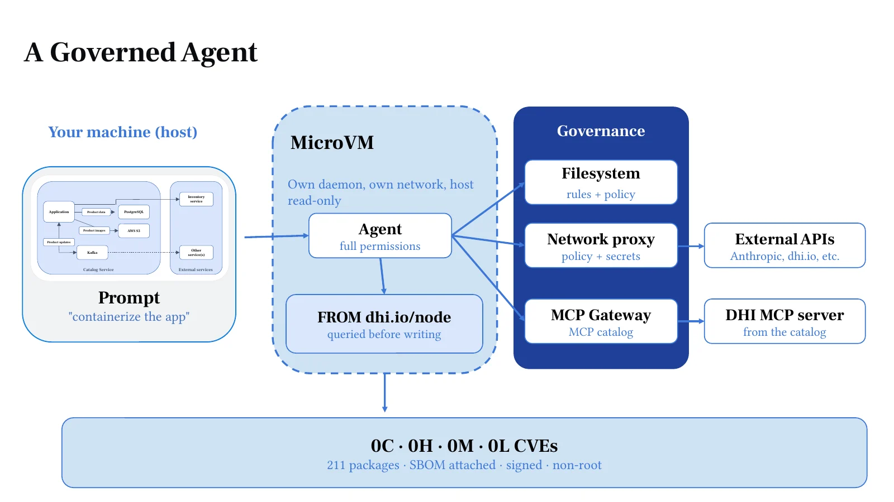

Note: Now the same prompt as our ungoverned agent: containerize the app. But this time it runs inside a sandbox, with its own daemon and its own network. Before writing the Dockerfile, the agent asks the DHI MCP server for a hardened base, and it picks dhi.io/node. The result: 211 packages, zero critical, zero high, zero medium, zero low CVEs. SBOM attached, signed, non-root. Same agent. Same prompt. Different environment.

---

<!-- chrome: false -->

Note: Now the same prompt as our ungoverned agent: containerize the app. But this time it runs inside a sandbox, with its own daemon and its own network. Before writing the Dockerfile, the agent asks the DHI MCP server for a hardened base, and it picks dhi.io/node. The result: 211 packages, zero critical, zero high, zero medium, zero low CVEs. SBOM attached, signed, non-root. Same agent. Same prompt. Different environment.

---

<!-- chrome: false -->

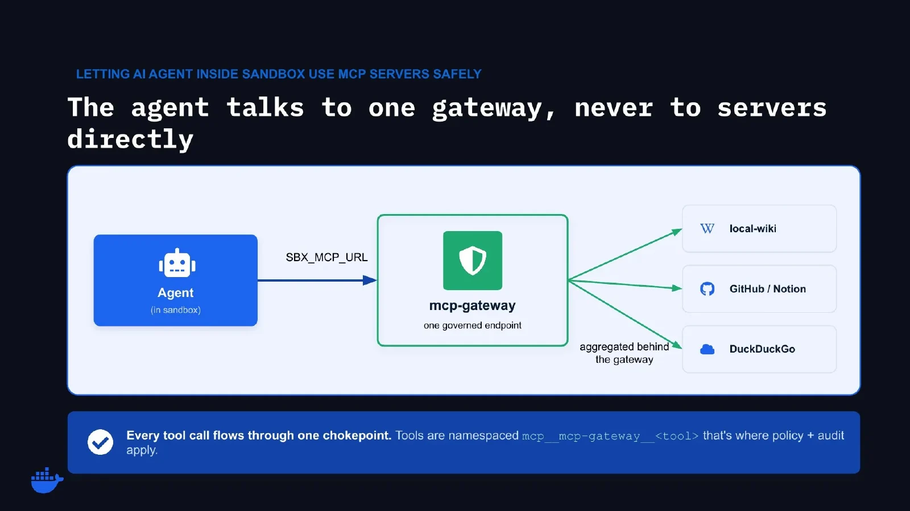

Note: The one idea everything hangs onThe agent never talks to those tool-servers directly. It talks to one gateway, and the gateway talks to the servers. That single chokepoint is where authorization, credentials, and audit happen. Every command in the runbook is really just "set up that gateway path" or "manage what's behind it."

---

<!-- chrome: false -->

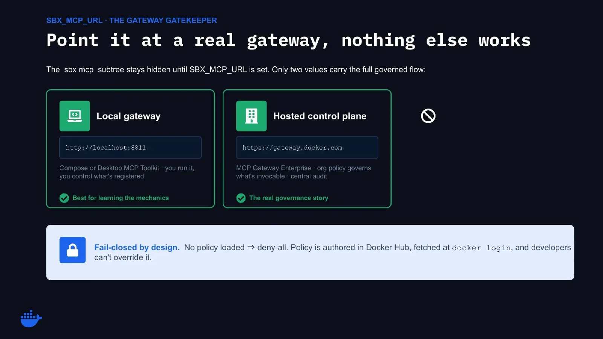

---

<!-- chrome: false -->

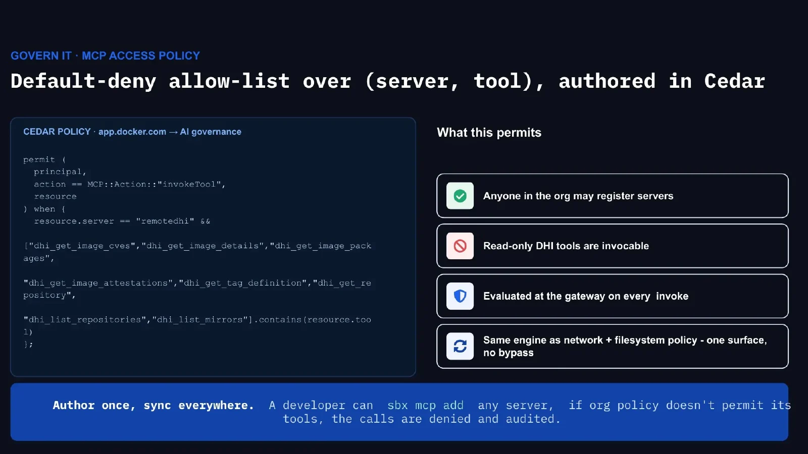

---

<!-- chrome: false -->

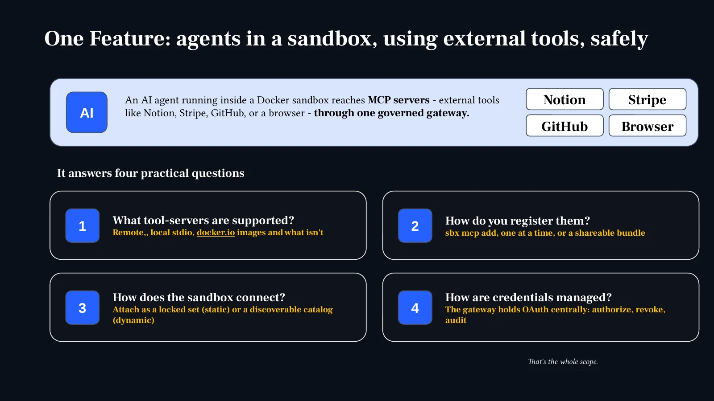

Note: All about runbook….It's the operations guide for one feature: letting an AI agent running inside a Docker sandbox use MCP servers (external tools — Notion, Stripe, GitHub, a browser, etc.) safely. It answers four practical questions: what tool-servers are supported, how you register them, how the sandbox connects to them, and how you manage their credentials. That's the whole scope.

---

<!-- chrome: false -->

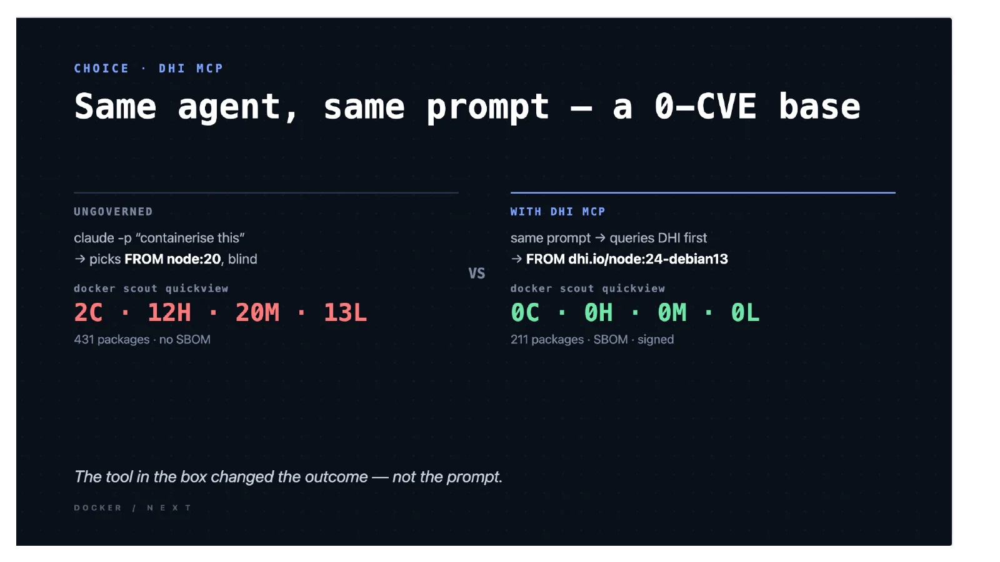

---

<!-- chrome: false -->

Note: Run the docker/ai-reviewer project

---

<!-- chrome: false -->

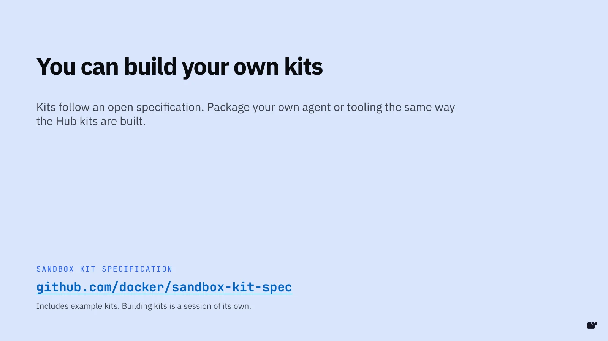

Note: And yes, you can build your own. Kits follow an open spec, and the repo has some examples to crib from. If your team has a weird internal tool or a custom agent, you can package it up exactly the same way. But building kits is really its own session, so I'll just leave the link here and move on before I get too excited.

---

<!-- chrome: false -->

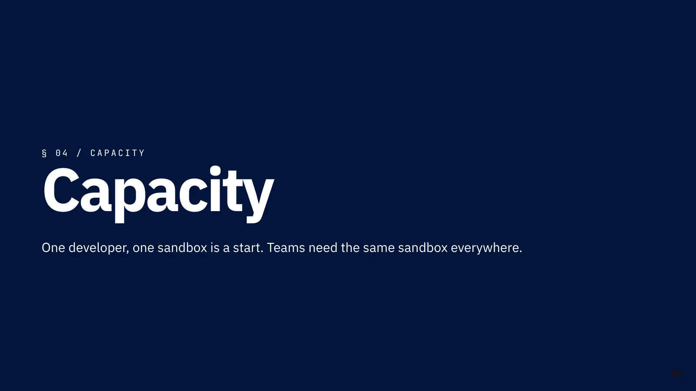

Note: Last pillar, Capacity. One developer with one nice sandbox is a great start. But the real payoff is when your whole team, and your automation, gets the exact same sandbox every single time.

---

<!-- chrome: false -->

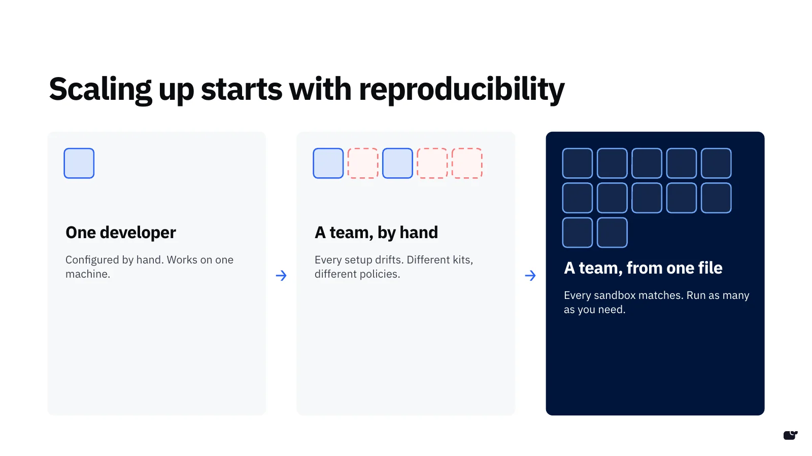

Note: And the secret to scale is reproducibility. One developer setting things up by hand? Totally fine. Now do that across a team. Somebody's on an old kit, somebody forgot a tool, somebody else has a slightly different setup, and suddenly nothing quite matches. Before you can run lots of sandboxes, you need every sandbox to be the same. And that means describing it once, in a file.

---

<!-- chrome: false -->

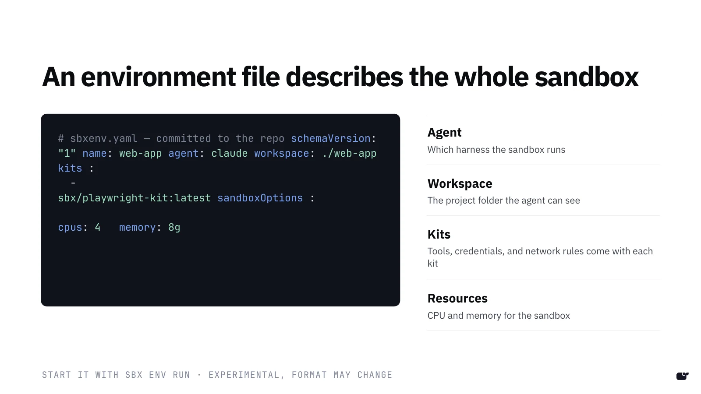

Note: That file is the sandbox environment file, sbxenv.yaml. It's pretty small. You say which agent to run, which folder is the workspace, which kits to pull in, and how much CPU and memory to give it. Notice what's not in here: no network rules. That stuff comes with the kits. Then you run sbx env run, it shows you a plan, you approve it, and you're in. Heads up, this is experimental right now, so the format may still change.

---

<!-- chrome: false -->

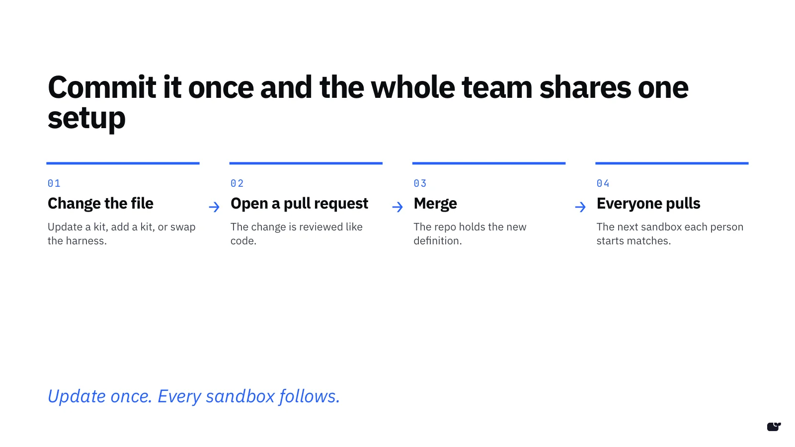

Note: And here's the payoff. That file goes in your repo. Need to update a kit, add a new one, or swap the harness? Change the file. Open a pull request. It gets reviewed like any other code. Merge it. And the next time anyone on the team starts their sandbox, they get the new version. Update once, and every sandbox follows. No more wiki page titled how to set up your agent, last updated two years ago.

---

<!-- chrome: false -->

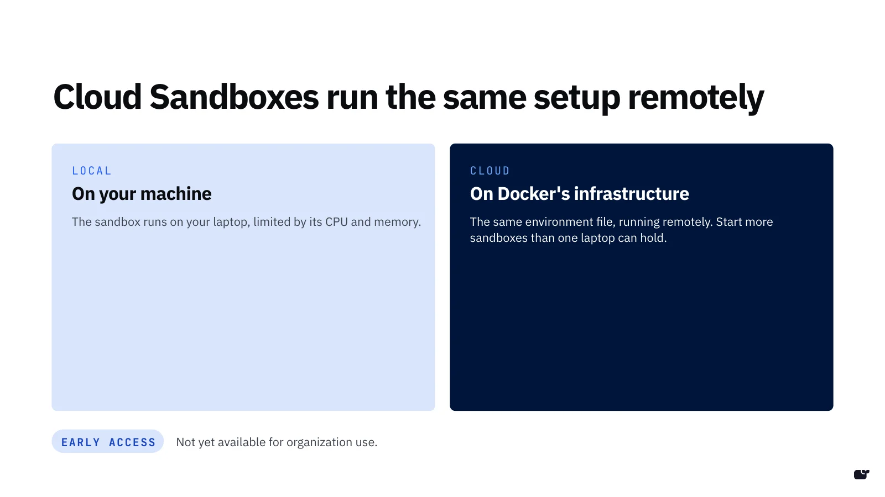

Note: Quick peek at what's coming. Right now your sandbox runs on your laptop, so you're limited by your laptop's CPU and memory. Cloud Sandboxes take that same environment file and run it on Docker's infrastructure instead, so you can spin up more sandboxes than one machine could ever handle. It's early access and not ready for organization use yet, so I won't spend long here. But notice it's the same file. That's why reproducibility matters so much.

---

<!-- chrome: false -->

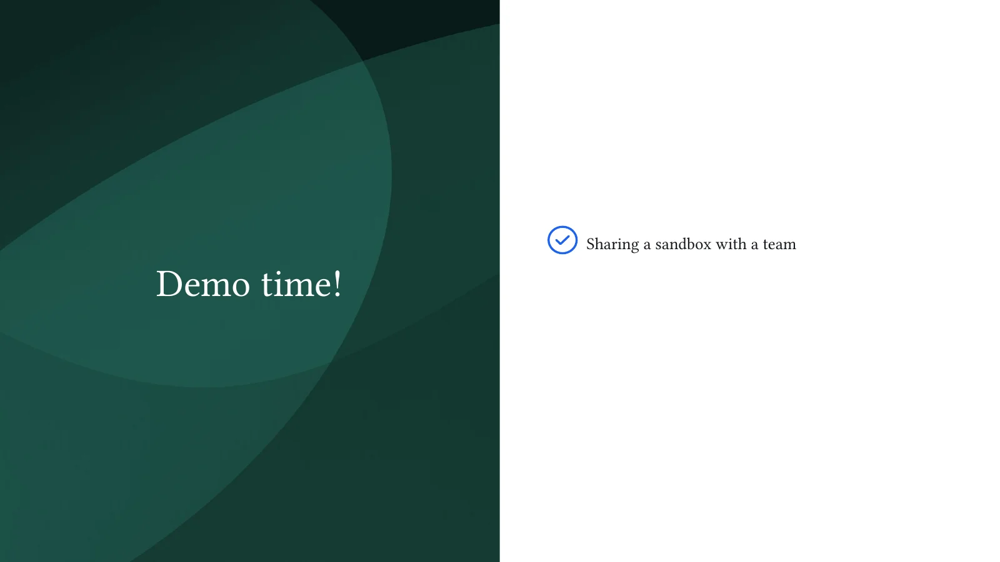

Note: Run the docker/ai-reviewer project

---

<!-- chrome: false -->

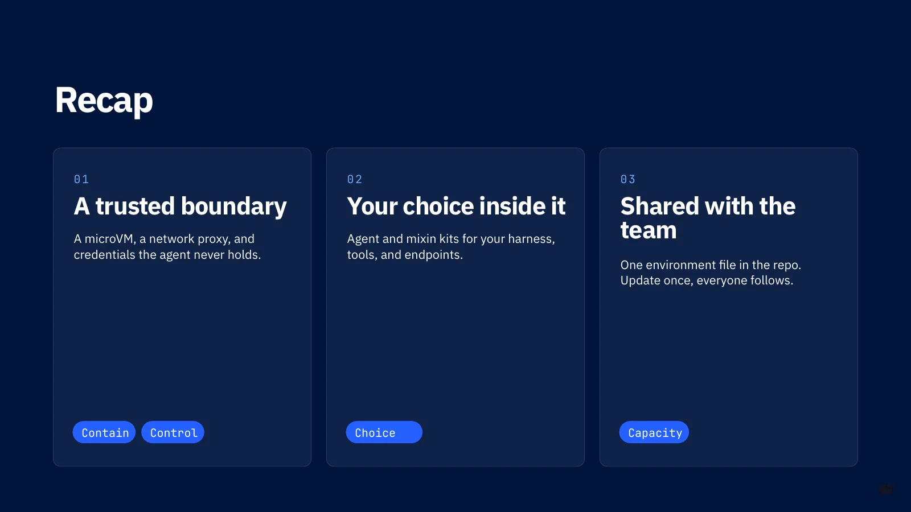

Note: Alright, let's wrap it up. Three things. One, a trusted boundary. The microVM, the network proxy, and credentials the agent never holds. That's Contain and Control. Two, it's your choice what goes inside. Agent kits and mixin kits for your harness, your tools, your endpoints. That's Choice. And three, you share it with the team. One environment file in the repo, update once, everyone follows. That's Capacity. Boundary, choice, sharing.

---

<!-- chrome: false -->

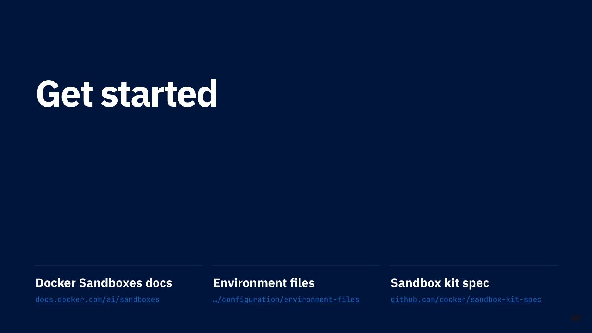

Note: If you want to try this out, here's where to go. The Docker Sandboxes docs are the best place to start. There's a page on environment files if you want to set up team sharing. And if you want to build your own kits, check out the spec repo. Thanks so much, everyone. I think we've got a few minutes for questions.
