<!-- chrome: false -->

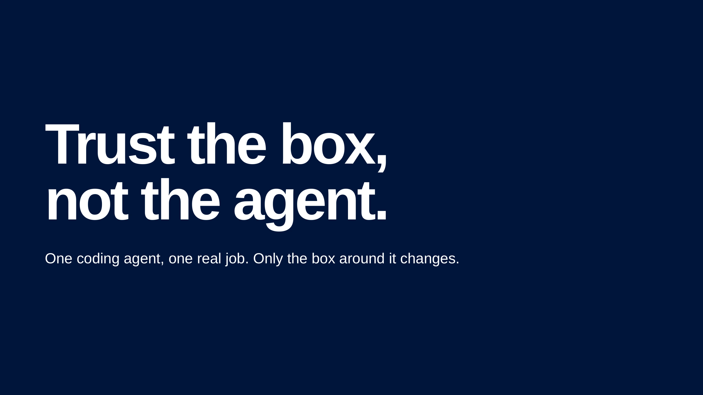

Note: Open here. The whole talk is one agent, one job, run twice — once loose on the host, once in a box. The agent never gets more trustworthy. The box does.

---

<!-- chrome: false -->

Note: Five parts. ~3m on the traditional SDLC, ~7m on the agentic one and its seven problems, ~20m on the four C's and their live demos, ~8m on governance, ~3m to land it. The labs are the hands-on half.

---

<!-- chrome: false -->

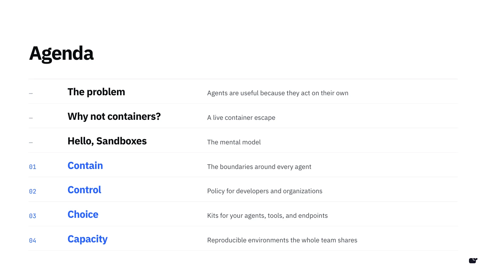

Note: The lethal trifecta. Every agent worth using has all three by design — that's why the fix has to be a boundary at runtime, not a better prompt. You can't train, prompt, or policy-document it out.

---

<!-- chrome: false -->

Note: The app is realistic enough to be dangerous: to do its job it needs a DB password, cloud keys, an inventory key, a Docker engine, and network. That's the whole "what weakens isolation" list, forced on stage by one app. github.com/dockersamples/catalog-service-node.

---

<!-- chrome: false -->

Note: Twenty years of security assumes a person is the actor at each gate. A human is slow — and that slowness is what caught the bad decision. "Why is there an AWS key in this Dockerfile?"

---

<!-- chrome: false -->

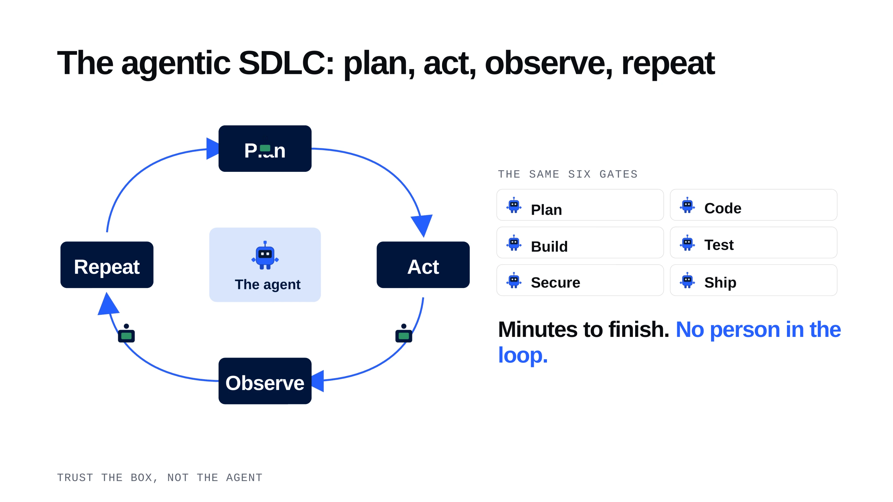

Note: Same six stages, same app. The only thing removed is the person. Minutes to finish, no human in the loop — everything the person used to catch now ships.

---

<!-- chrome: false -->

Note: This is the prompt, run the way people really run it — YOLO, on the host, "don't ask me." The tests will go green. It will also fail every review the old SDLC had.

---

<!-- chrome: false -->

Note: Seven real steps, each reasonable in isolation, tests green throughout. The row numbers carry through to the scoreboard at the end — remember them.

---

<!-- chrome: false -->

Note: Group the seven into three. This is the whole problem statement — and each of the four C's will close a specific group. The agent didn't go rogue; it had our keys, our socket, and our network.

---

<!-- chrome: false -->

Note: These are real incidents. The usual answer is approve-everything (you're the bottleneck) or YOLO (your access, none of your judgment). We refuse both: fast AND safe, no babysitting.

---

<!-- chrome: false -->

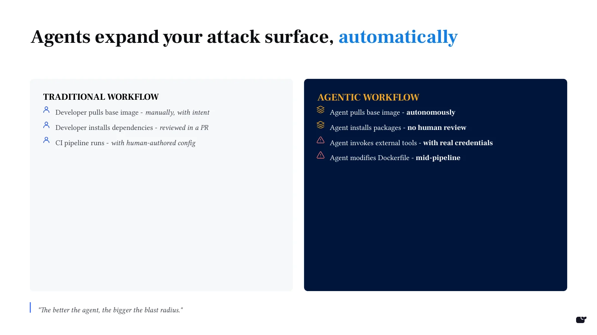

Note: A container is a fine boundary for an application. An agent needs credentials, a Docker engine, and the network — and each one weakens the container until it isn't one. Dashed line = a hole in the wall.

---

<!-- chrome: false -->

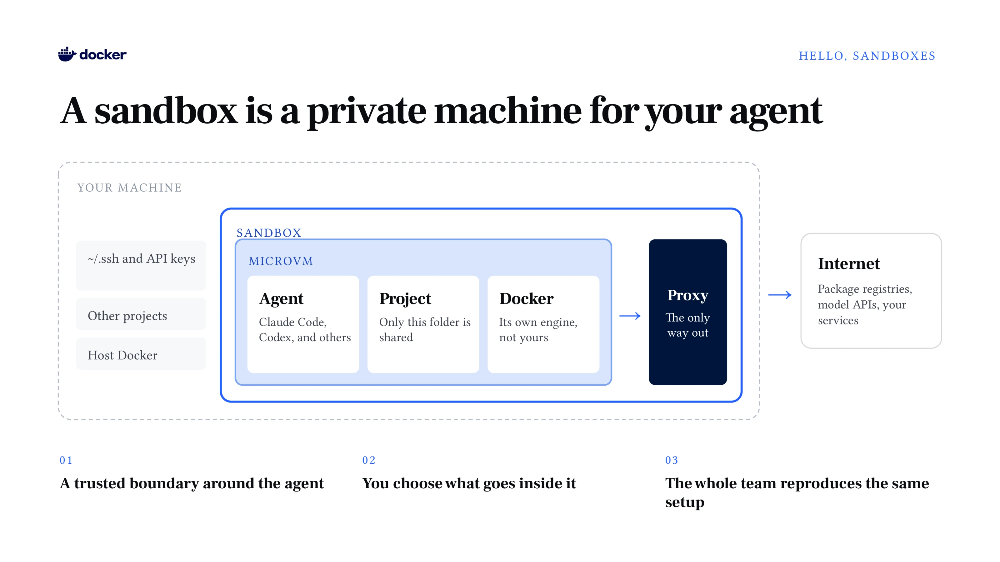

Note: Hello, Sandboxes. A sandbox is a private machine for the agent: its own kernel and Docker engine, only the project shared, and a proxy as the single exit. Full freedom inside, a hard wall at the edge. Three ideas carry the rest of the talk — a trusted boundary, you choose what's inside, the whole team reproduces it.

---

<!-- chrome: false -->

Note: The core difference. An escape from a container targets your kernel; an escape from a sandbox must cross the hypervisor. Sudo inside a sandbox is fine — it's root of a throwaway VM, not your laptop. We took the kernel out of the equation.

---

<!-- chrome: false -->

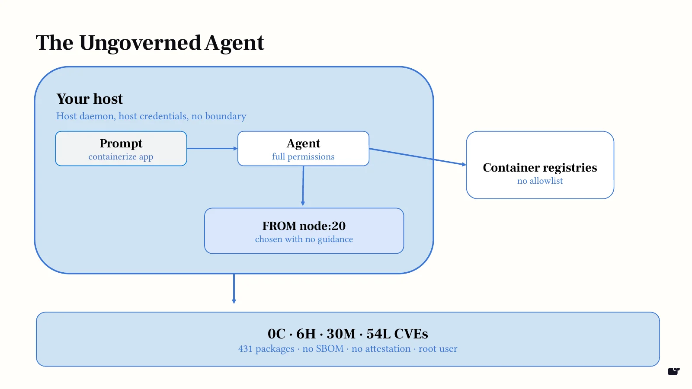

Note: The map for the rest of the talk. Four pillars, each closes specific rows from the scoreboard. Each gets one explainer and one live demo. Same agent, same prompt — only the box changes.

---

<!-- chrome: false -->

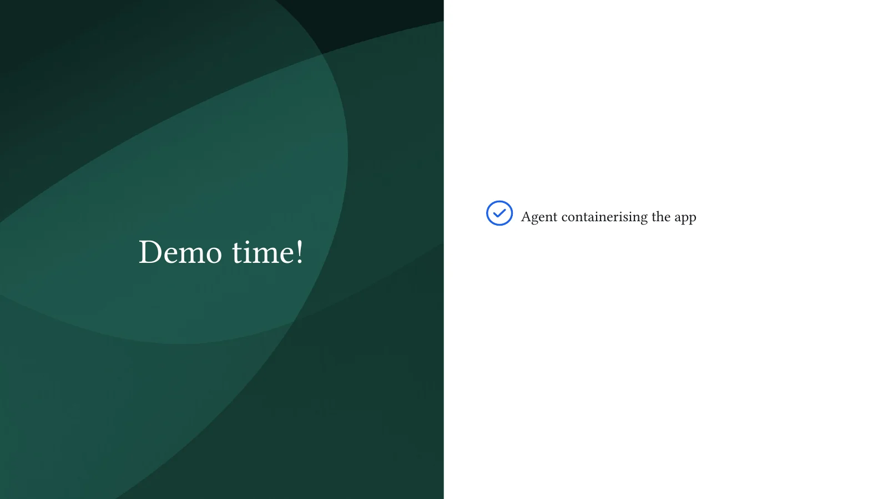

Note: Contain is the boundary itself. Total freedom inside, a hard wall at the edge. The next slide is the live, interactive version — flip it between "no sandbox" and "in a sandbox."

---

<!-- chrome: false -->

<iframe src="labs/trust-the-box-slides/assets/the-box.html" title="The Box — what the agent can reach, with and without a sandbox" style="position:absolute;inset:0;width:100%;height:100%;border:0;background:#fff"></iframe>

Note: DEMO. Start on "No sandbox" — ask it to find passwords, free up disk: it walks right in. Flip to "In a sandbox": only the project came in with it; everything else bonks off the wall. The key never enters the VM, so `COPY . .` has nothing to bake.

---

<!-- chrome: false -->

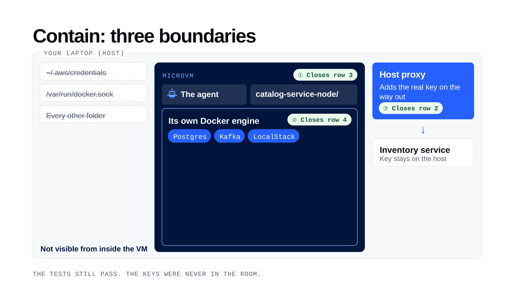

Note: Three boundaries, three rows closed. The microVM hides the host (row 3), its own Docker engine replaces the socket (row 4), and the proxy adds the real key on the way out so it's never in the VM (row 2). The tests still pass; the keys were never in the room.

---

<!-- chrome: false -->

Note: Zoom in on credential injection. Inside the sandbox `echo $INVENTORY_API_KEY` is empty, yet `curl localhost/inventory/42` returns 200. The agent holds no key, so `COPY . .` runs again with nothing real to bake into the layer. Row 2, closed.

---

<!-- chrome: false -->

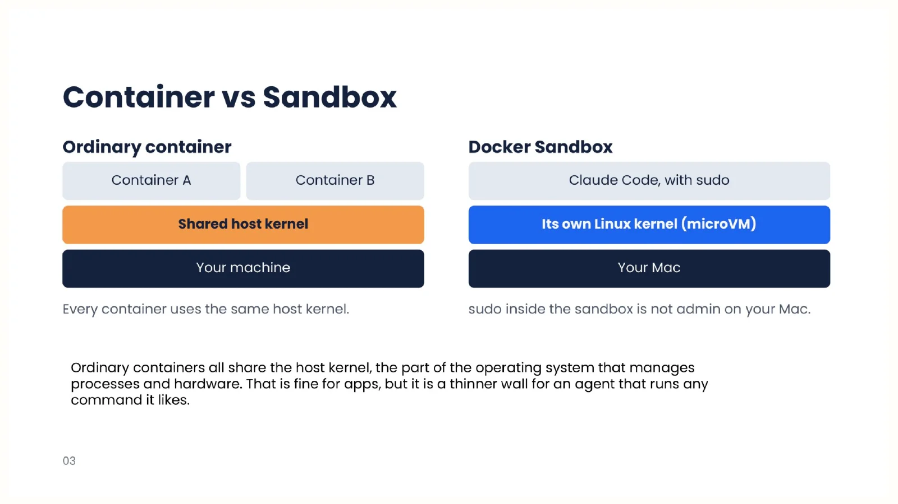

Note: Same prompt, one new word: `sbx run claude`. ~/.aws is missing, Testcontainers use the sandbox's own engine, the key isn't in the env. Rows 2, 3 and 4 — closed by Contain alone.

---

<!-- chrome: false -->

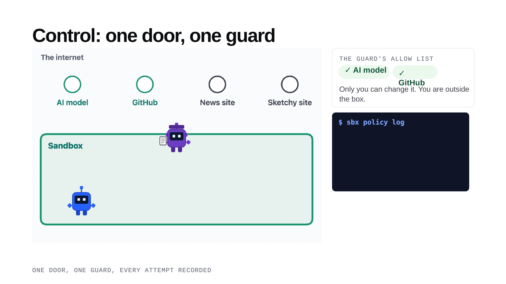

Note: Control decides where the wall sits. One door, one guard, every attempt recorded. The allow-list lives outside the box — only you can change it. Live demo next.

---

<!-- chrome: false -->

<iframe src="labs/trust-the-box-slides/assets/the-door.html" title="The Door — the guard, the allow-list, and the policy log" style="position:absolute;inset:0;width:100%;height:100%;border:0;background:#fff"></iframe>

Note: DEMO. Send messages to the AI model and GitHub (allowed) and to the news/sketchy hosts (denied). Watch the guard's allow-list and the live `sbx policy log` fill with ALLOW/DENY — the exfil host from row 5 is blocked and recorded.

---

<!-- chrome: false -->

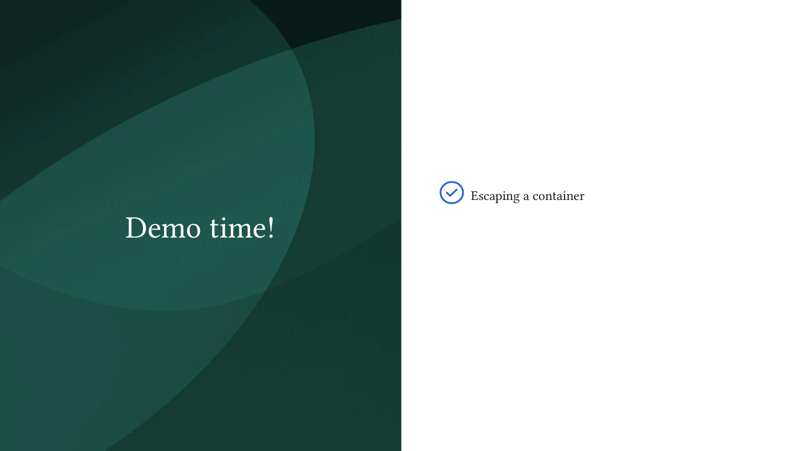

Note: Developers pick a profile — Balanced here. The proxy allows the common dev endpoints, denies the exfil host, and `sbx policy log` records every decision. Closes row 5, starts on row 6.

---

<!-- chrome: false -->

Note: The organization writes one policy in Docker Home — default-deny, enforced on every sandbox. A local allow rule goes inactive under org policy; blocked requests say "blocked by org policy," so the developer knows who to ask.

---

<!-- chrome: false -->

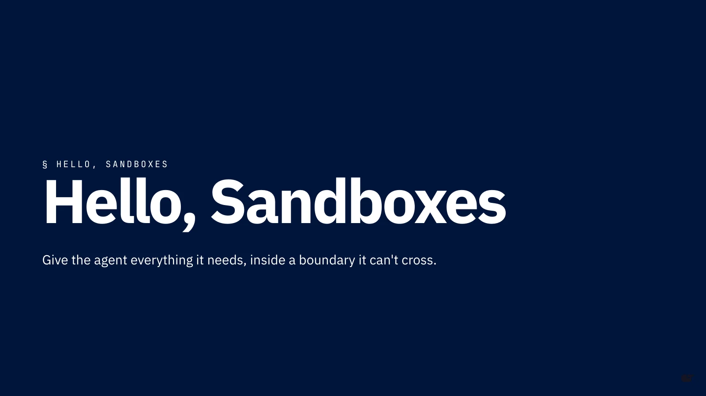

Note: One policy, written once in Docker Home, covers three surfaces: network (default-deny allow-list), filesystem (mountable paths, read or write per path), and MCP tools (Cedar — read allowed, write needs approval).

---

<!-- chrome: false -->

Note: The governance flow: admin writes one policy, scopes it to a pilot team, requires org sign-in, and the proxy decides every request. The audit log exports to a SIEM — security sees row 5's blocked request, unasked.

---

<!-- chrome: false -->

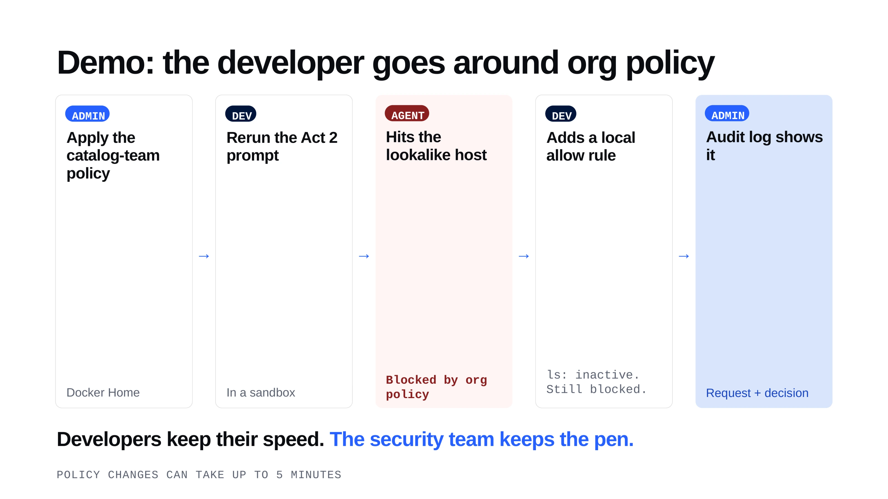

Note: DEMO arc. Apply the catalog-team policy, rerun the Act 2 prompt, the agent hits the lookalike host and is blocked by org policy. The developer adds a local allow rule — it stays inactive. The audit log shows the attempt. Developers keep their speed; security keeps the pen.

---

<!-- chrome: false -->

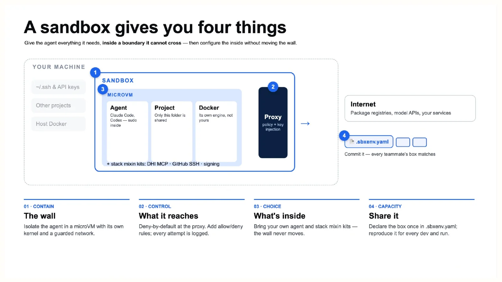

Note: Choice is what makes a locked box usable. Same walls, better tools inside: swap the agent kit (Claude Code ⇄ Codex), stack mixin kits (dhi-mixin, scanners). The boundary does not move. Starts closing rows 1 and 6.

---

<!-- chrome: false -->

<iframe src="labs/trust-the-box-slides/assets/the-kit.html" title="The Kit — add kits to the box and harden the base image" style="position:absolute;inset:0;width:100%;height:100%;border:0;background:#fff"></iframe>

Note: DEMO. Dock the agent kit and mixins into the box, then "harden the base" — watch 8 High CVEs drop to 0 while the boundary stays exactly where it was.

---

<!-- chrome: false -->

Note: Tools reach the agent through one governed gateway: Cedar policy, default-deny, every invoke checked and audited. Reads allowed, writes need approval, unregistered servers denied. Fail closed — no policy loaded means deny all.

---

<!-- chrome: false -->

Note: One declarative kit pins the agent to hardened images: register the DHI MCP, steer the agent (soft), allow dhi.io, and deny third-party registries at the network edge (hard). Steering asks; the deny guarantees — deny beats allow.

---

<!-- chrome: false -->

Note: The payoff. The agent rewrites `FROM node:20` (47 CVEs, 431 packages, root) to `FROM dhi.io/node` (0 CVEs, 211 packages, SBOM, signed, non-root). Same prompt, better base. Row 1 closed — numbers straight from the lab run.

---

<!-- chrome: false -->

Note: Capacity turns one good box into the team's box. One `sbxenv.yaml` in the repo describes agent, kits and resources; every teammate runs `sbx env run` and gets the identical sandbox. A kit change is a pull request. Row 7 closed.

---

<!-- chrome: false -->

<iframe src="labs/trust-the-box-slides/assets/the-file.html" title="The File — one sbxenv.yaml, four identical boxes" style="position:absolute;inset:0;width:100%;height:100%;border:0;background:#fff"></iframe>

Note: DEMO. "By hand": four laptops drift into four different setups. Flip to "From the file": one sbxenv.yaml, four identical boxes. Update once, every sandbox follows — on any machine, laptop or cloud.

---

<!-- chrome: false -->

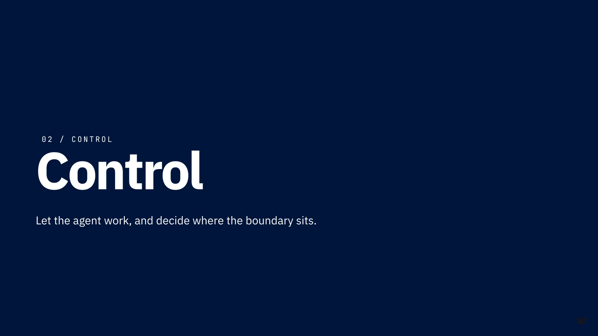

Note: The same file runs in the cloud — one agent hardens the Dockerfile, another writes tests, another updates the Kafka client, all at once. Two policies: org governance covers local sandboxes; cloud sandboxes use their own network policy (`sbx --cloud policy`).

---

<!-- chrome: false -->

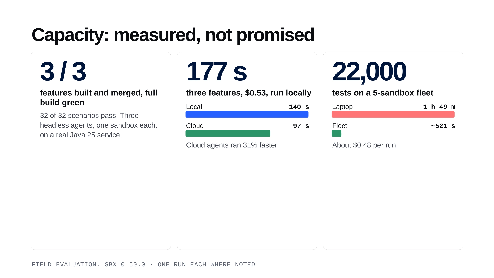

Note: Not a promise, a measurement. Three headless agents merged 3/3 features (32/32 scenarios) in 177s locally; cloud agents ran 31% faster; a 5-sandbox fleet ran 22,000 tests in ~521s vs 1h49m on a laptop. Field evaluation on sbx 0.50.0.

---

<!-- chrome: false -->

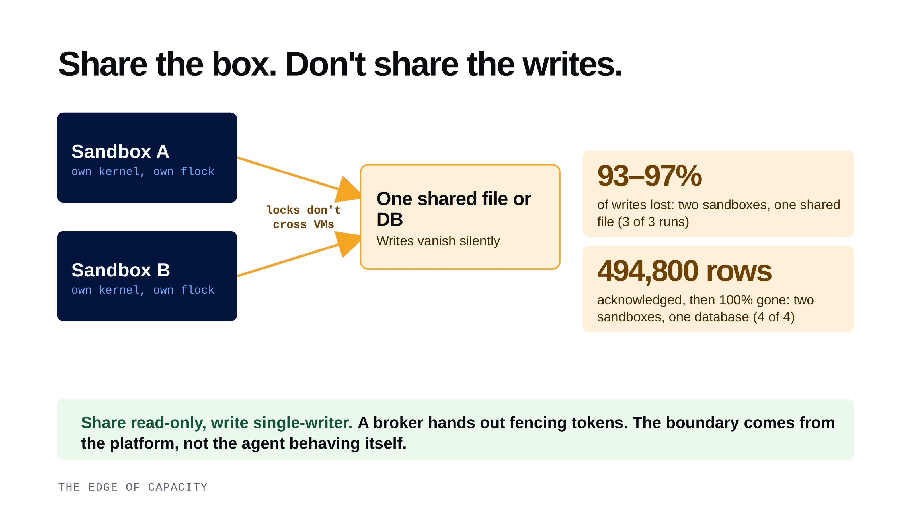

Note: The edge of Capacity. The same isolation that makes each sandbox safe — its own kernel — is what makes shared writes unsafe: 93–97% of writes lost on a shared file, 494,800 rows acknowledged then gone, locks don't cross VMs. Fix has the same shape as the box: share read-only, write single-writer, with a broker handing out fencing tokens.

---

<!-- chrome: false -->

Note: Seven rows, four pillars, every one closed — and we never made the agent more trustworthy. Point at each row and name its C.

---

<!-- chrome: false -->

Note: Same agent, same prompt, a different box. Read the two columns straight down — base image, credentials, Docker, network, team setup, evidence — every line flips from liability to evidence.

---

<!-- chrome: false -->

Note: Land the title one last time. Point them at the labs that pair with this deck — the same Product Catalog, the same four C's, hands-on at sandboxing.dockerworkshop.com. Thank the room.
